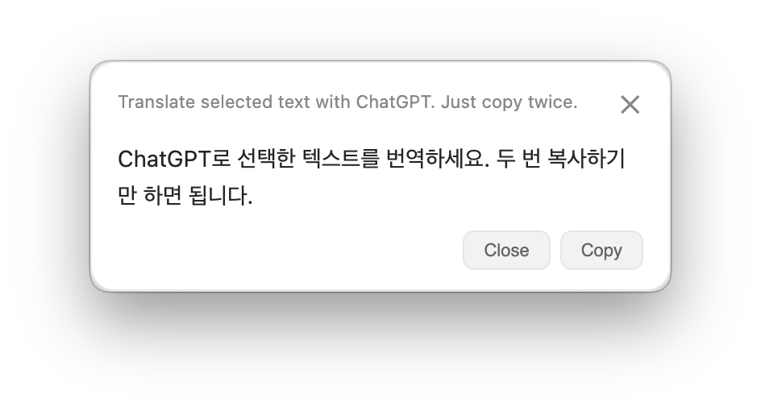

# CC Translate

Translate selected text with ChatGPT. Just copy twice.



## Use

1. Sign in to ChatGPT and allow Accessibility access.
2. Select text, hold **⌘**, and press **C twice**.
3. **Copy** the translation or press **Esc** to close.

Set **Translate to**, choose a model, and adjust **Translation style** in Settings. Uses your ChatGPT subscription—no API key needed.

## Install

Requires macOS on Apple Silicon, Node.js 20+, and Xcode Command Line Tools.

```sh
npm ci
npm run dist
```

Move `dist/mac-arm64/CC Translate.app` to Applications. If macOS blocks it, choose **Open Anyway** in Privacy & Security.

## License

[MIT](LICENSE). Based on [sirenko-translator](https://github.com/golatam/sirenko-translator) by Kirill Sirenko. Independent project; not affiliated with OpenAI.
